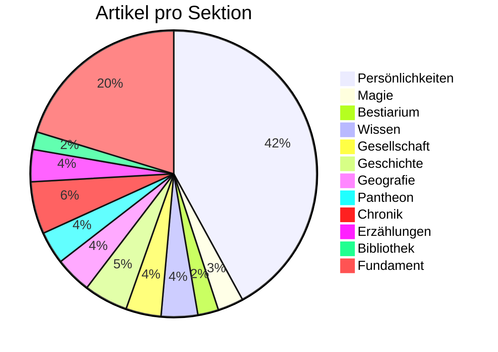

# 📊 Siebenwind Kompass

**Stand:** 2026-10-22 13:25

> Umfang des erschlossenen Wissens. Offene Fragen und Quellenlage werden gesondert ausgewiesen.

---

## 🌍 Welt Heute

| Kennzahl | Wert |
| :--- | :--- |
| Artikel | **1418** |
| Worte | **218,650** |
| Durchschnittliche Artikellänge | **154 Worte** |
| Interne Verweise (`[[...]]`) | **13,380** |
| Vernetzungsdichte | **9.4 Links/Artikel** |
| Personenprofile | **591** |

---

## 🔄 Was sich bewegt

| Zeitraum | Bearbeitete Wiki-Artikel | Neue Wiki-Artikel | Aktive Tage |
| :--- | :--- | :--- | :--- |
| Letzte 7 Tage | 0 | - | 0 |
| Letzte 30 Tage | 0 | 0 | 0 |
| Letzte 90 Tage | 94 | - | 5 |

---

## 🧭 Sektionen

## 📚 Lesetiefe nach Sektion (Top 5)

| Sektion | Artikel | Ø Worte/Artikel | Ø Links/Artikel |
| :--- | ---: | ---: | ---: |
| Pantheon | 52 | 415 | 10.9 |
| Erzählungen | 51 | 345 | 9.3 |
| Magie | 41 | 277 | 9.8 |
| Chronik | 83 | 271 | 31.6 |
| Wissen | 58 | 267 | 9.8 |

---

## 🏆 Entdecke die Welt

### Häufig verlinkte Themen
| Thema | Verweise |
| :--- | ---: |
| [[Falkensee]] | 550 |
| [[Brandenstein]] | 543 |
| [[Siebenwind]] | 487 |
| [[Bellum]] | 164 |
| [[Astrael]] | 159 |
| [[Nortraven]] | 148 |
| [[Vitama]] | 137 |

### Häufig verlinkte Persönlichkeiten
| Persönlichkeit | Verweise |
| :--- | ---: |
| [[Toran_Dur]] | 134 |
| [[Custodias]] | 71 |
| [[Waldemar_Delarie]] | 54 |
| [[Dunvallo_Linari]] | 50 |
| [[Solos_Nhergas]] | 45 |
| [[Hagen_Robaar]] | 41 |
| [[Laske]] | 40 |

### Häufig verlinkte Ereignisse
| Ereignis | Verweise |
| :--- | ---: |
| [[Siebenwind_Bote_172]] | 20 |
| [[Dunkeltief_29_nH]] | 19 |
| [[Siebenwind_Bote_175]] | 19 |
| [[Siebenwind_Bote_186]] | 19 |
| [[Siebenwind_Bote_173]] | 18 |
| [[Das_Ende_der_Zeit_der_Koenige]] | 17 |
| [[Siebenwind_Bote_180]] | 17 |

---

## Quellenlage und offene Fragen

537 von 1418 Artikeln (37.9 %) haben ein aufgelöstes `quelle`-Metadatenfeld.
Das misst Metadatenabdeckung, nicht den Anteil belegter Aussagen. Belege können auch im Text stehen.
337 Ungeklärt-Markierungen zeigen offene Wissensfragen.

Linkhäufigkeit beschreibt Vernetzung; LQS beschreibt formale Qualität. Beide sind kein Wahrheitsmaß.
Auch die Tags sind keine neue Prüf- oder Vertrauenszusage.
Bei Widersprüchen gilt Homepage > Quellen > Wiki Pages.

[Quellen und Forschung](../../forschung.md) · [Neues im Archiv](../../neues.md) · [Betrieb und Prüfstand](../../Agenten/status.md)
